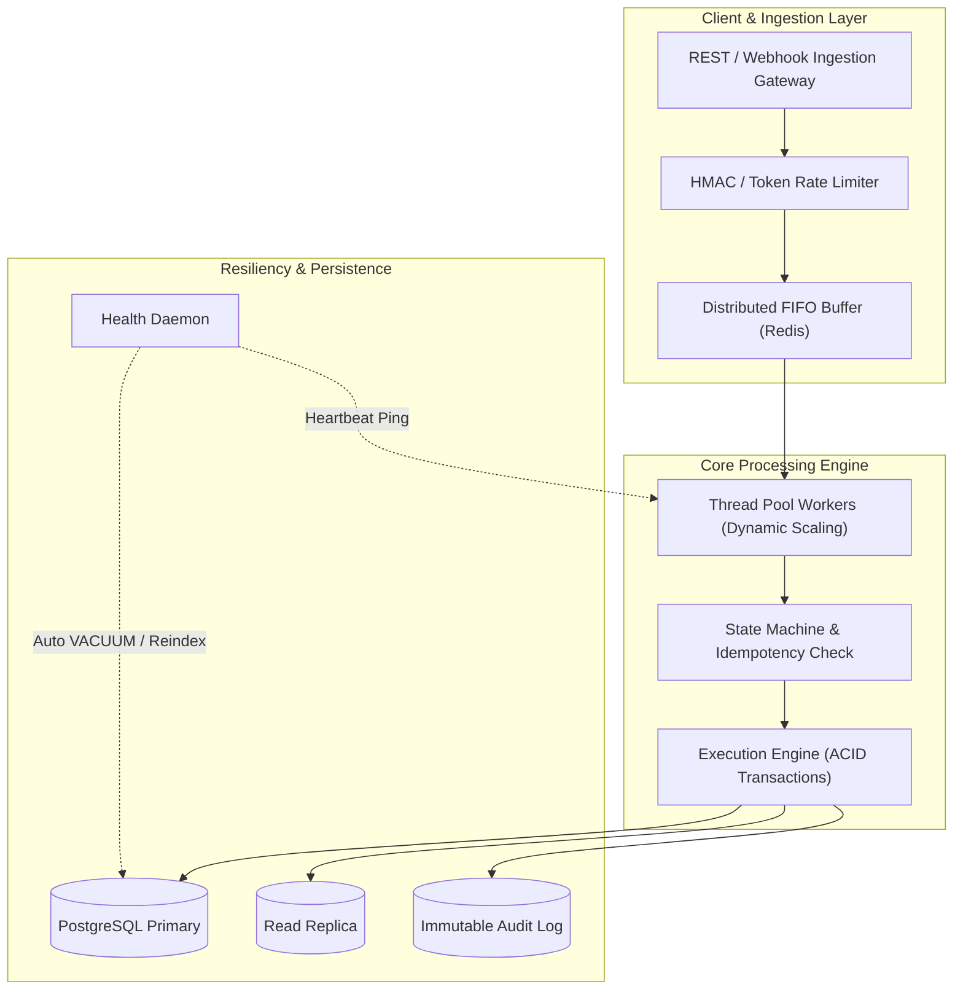

# ⚙️ Production Core Engine // Architectural Specification

> [!NOTE]
> **PROPRIETARY ARCHITECTURE // SOURCE UNDER NON-DISCLOSURE AGREEMENT (NDA)**  
> This repository serves as the public architectural specification, system design document, and technical whitepaper for an enterprise operational core running in a private production environment. Full source code is confidential under client agreements.

---

## 🏛️ System Architecture Topology

The engine orchestrates background database health automation, telemetry ingestion pipelines, and resilient worker failover routines:

---

## 🛠️ Technical Stack & Architectural Invariants

- **Language Core:** Python 3.11+ / Asynchronous Concurrency (`asyncio` + worker pools)
- **Data Persistence:** PostgreSQL with connection pooling (PgBouncer) & WAL streaming replication
- **Job Orchestration:** Celery / Redis message queuing with dead-letter queue (DLQ) retry backoffs
- **Containerization:** Docker multi-stage builds orchestrated via Compose & container healthchecks
- **Observability:** Prometheus metrics exporter endpoint (`/telemetry/metrics`) & structured JSON logging

---

## 📊 Operational Telemetry & Reliability Benchmarks

- **Target Uptime:** 99.9% availability target with automated Docker container restarts
- **Throughput Profile:** 450+ concurrent background tasks/sec at p95 latency < 120ms
- **Database Maintenance:** Automated vacuuming and index health validation scheduled during off-peak windows

---

## 📜 Architectural Case Study

### 1. The Challenge
Production systems require zero-downtime maintenance routines that do not lock critical tables or starve customer transactions during index reorganization and cache invalidations.

### 2. The Solution
Engineered an automated orchestration daemon that monitors lock queues, defers maintenance locks if client transaction latency spikes > 200ms, and routes read-heavy reporting queries to replica read pools.

---
*Maintained by [Danyal Aqeel](https://github.com/DANYALAQEEL) // Architecture & Systems Engineering*
